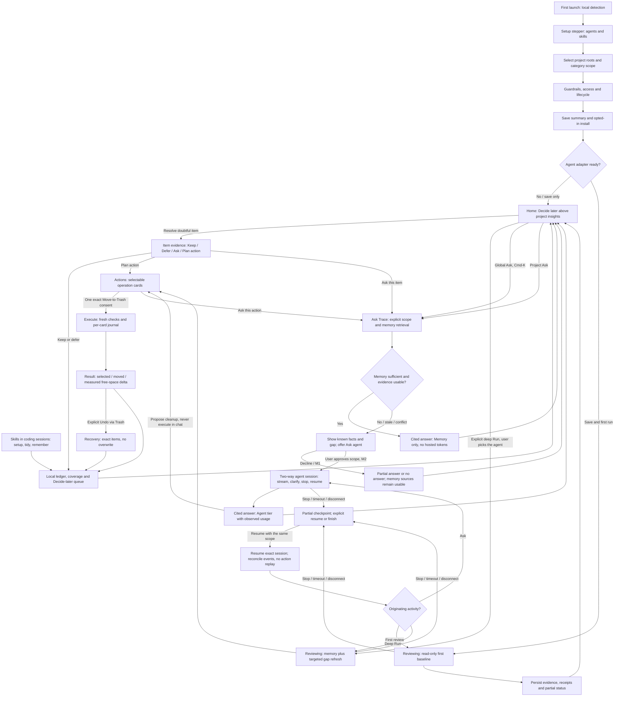

# Trace — Design & UX v0.2

Companion to [the PRD](prd.md) · 11 November 2026 (IST)

**Intent:** a colourful developer instrument, not a generic Mac cleaner or a Settings-window template. Minimal does not mean monochrome, and developer-native does not mean a wall of terminal output.

This specification describes the complete intended M2 experience. M0 has skills only; M1 implements Setup, local Home, memory-only Ask and read-only inspection and never teases enabled cleanup controls that do not work. All unvalidated visual numbers and behavior choices marked **Proposed** are starting decisions for dogfood, not immutable acceptance tests.

## 1. Design direction: “working traces”

### Principles

1. **Evidence is the interface.** Show what the artifact belongs to, why it exists and why the decision is credible. A pretty number cannot substitute for a source or uncertainty.
2. **Colour organizes; words authorize.** Use distinct artifact hues and separate semantic states. Always pair state with a label/icon. Green is not consent.
3. **One decision, one place.** Skills do everyday hygiene; Home explains outcomes; a deeper Run reviews, proposes action cards and executes one exact consent. Never duplicate Scan/Run/Clean buttons or require dismissal of a celebration before showing the result.
4. **Dense, calm, fast.** Align paths and tabular numbers. Keep essential evidence visible, details adjacent and navigation instant. No giant whitespace cards, health scores or ornamental charts.
5. **Reversible by design, honest by default.** Explain what moved, what stayed, what could not be verified and whether free space actually changed. A failure is a usable state, not a dead-end alert.

### References: borrow an idea, not a skin

- **[Linear's UI redesign](https://linear.app/now/how-we-redesigned-the-linear-ui):** borrow low-noise chrome, aligned dense information and role-based light/dark tokens. Do not copy its sidebar, branding, issue terminology or exact palette.
- **[Raycast](https://www.raycast.com/):** borrow immediate keyboard navigation and contextual actions that do not interrupt a task. The requested Ask Trace bar uses the familiar ⌘K pattern for scoped questions, not a universal launcher or separate competing chat tab.
- **[Warp blocks](https://docs.warp.dev/terminal/blocks/):** borrow self-contained units that keep an operation, its outcome and follow-up together. Use action/insight cards, not a terminal clone or an unbounded transcript.
- **[Ghostty's explicit keybindings](https://ghostty.org/docs/config/keybind):** borrow predictable, discoverable mappings and respect text-selection/copy behavior. No new global shortcuts or Accessibility permission just for navigation.
- **[Zed](https://zed.dev/):** borrow the adjacency of work, evidence and optional detail; keep the report legible alongside an inspector. Do not clone editor tabs, a code minimap or a terminal.

These are interpretations of public materials, not claims that a cited product implements Trace's flows. Trace's own identity is the **violet workspace, warm-light/ink-dark surfaces, multicolour artifact marks and precise mono measurements**, rather than copied chrome or a default SwiftUI Form.

## 2. Theme and component language

### Named palette: “Prism / Ink”

Follow system appearance initially, with Light/Dark/System in Settings. Solid, very slightly tinted surfaces; no gradient wallpaper, glass-on-glass, neon glow, traffic-light status dashboards or frosted evidence cards. Keep native macOS window controls, menus, selection and accessibility behavior; build a deliberate custom content hierarchy.

**Proposed tokens — use these role names, not hardcoded colours in individual screens.**

| Role / token | Light: Prism | Dark: Ink | Use |
| --- | --- | --- | --- |
| `canvas` | `#F5F3FF` | `#14131D` | Window background, never a decorative gradient. |
| `surface` | `#FFFFFF` | `#1D1B2B` | Cards, inputs and main content. |
| `elevated` | `#EEEBF8` | `#262238` | Inspector, expanded evidence, selected-project background. |
| `text.primary` | `#202033` | `#F4F1FF` | Essential labels, reasons and sizes. |
| `text.secondary` | `#626075` | `#B8B2C9` | Paths, provenance dates and supporting copy. |
| `line` | `#8B849F` | `#837A9A` | Functional control edges; quieter dividers may use a separate nonessential token. |
| `brand` | `#6D42C5` | `#B99BFF` | Primary action, active navigation and selection mark. |
| `on.brand` | `#FFFFFF` | `#191322` | Text/icons on brand fills. |
| `focus` | `#8054D5` | `#D3BEFF` | Visible keyboard outline, distinct from selection. |
| `safe` — Fern | `#16714E` | `#68D5A5` | Check + “Verified disposable”; never “guaranteed safe”. |
| `review` — Ochre | `#945B00` | `#F1C56B` | Hollow diamond + “Needs review” or “Partial”. |
| `critical` — Rose | `#B43C53` | `#FF98AD` | Lock + “Protected”; error uses warning icon and explicit copy. |
| `freed` — Glacier | `#006C86` | `#6DD7F0` | Measured free-space increase only, not selected bytes. |

**Category accents** are a 3 px leading mark, small icon or labelled text, not full-row background fills. Their job is recognition, not safety classification.

| Category | Light | Dark | Icon / explicit label |
| --- | --- | --- | --- |
| Caches — Honey | `#776005` | `#E7CF70` | Stack / Caches |
| Builds — Cobalt | `#3560B8` | `#92B6FF` | Hammer / Builds |
| Worktrees — Iris | `#8050A7` | `#CEABF5` | Branch / Worktrees |
| Containers — Lagoon | `#087780` | `#70D3DD` | Shipping box / Containers |
| Models — Orchid | `#A24178` | `#F3A0CC` | Layered cube / Models |
| Data / other project artifacts | `text.secondary` | `text.secondary` | Database or file / actual kind |

Use semantic colours only for labelled state and category hues only for labelled kind; do not infer state from a hue. A purple worktree can still be Protected. A selected card has a thin brand edge and a checkmark; hover uses elevated surface, not another state colour. Buttons use brand fill for the single primary action and neutral text/outline for secondary actions. A reversible Trash action stays brand-filled with an explicit action label; permanent tool-native removal must not masquerade as Trash.

Before shipping, check text contrast at least 4.5:1, large text and meaningful controls at least 3:1, in both themes and Increase Contrast. Adjust tokens rather than lowering contrast with arbitrary opacity. Disabled controls retain legible reasons; protected items are not rendered as unreadable dim text. Avoid tinted badge backgrounds unless their exact foreground pairing is checked.

### Typography

**Proposed:** SF Pro Text/Display for UI and SF Mono for paths, byte quantities, IDs and commands. These respect macOS while the layout and colour carry Trace's identity. Do not make every label monospace. Use tabular figures for measurements and elapsed time; keep full precision in accessible details.

| Role | Size / weight | Use |
| --- | --- | --- |
| Outcome / major measure | 28 pt semibold, tabular | One main outcome, never a wall of stats. |
| Screen/project heading | 20 pt semibold | Project or screen title. |
| Section | 15 pt semibold | Kept, Shared stores, Learnings. |
| Body / row title | 13 pt regular / medium | Essential explanation, controls. |
| Paths / sizes / commands | 12 pt mono regular | Secondary path, aligned measured size, copyable recipes. |
| Supporting metadata | 12 pt regular | Evidence source/date and stale/partial labels. |

No all-caps micro-labels below 12 pt. Respect larger text/accessibility preferences, allow wrapping and increase row heights instead of clipping. Elide long paths in the middle, preserving project context and the tail; inspector and copy/reveal expose the full path. Commands wrap in a selectable mono block and are never executed by clicking the text.

### Layout, spacing and components

**Proposed:** 4 pt base rhythm; gaps 4/8/12/16/24/32; window padding 24; content inset 16; 8 pt control radius, 12 pt sheet/inspector radius, 4 pt code-block radius. Dividers are 1 pt, no shadow stacks. Default window 1080 × 740 pt; support 840 × 600 pt and larger text. Inspector is about 320 pt when there is room; on narrow windows it replaces the report body with a breadcrumb back, preserving selection/scroll.

- **Chrome:** unified title bar (no separate black strip). **No in-app logo/wordmark.** Primary chrome is a **narrow right icon rail**, ordered **Home → Decide later → History → Settings**, then **Refresh → Run → Ask** (`⌘K`). Per-project memory/insights live on the **project card surface**, not a separate Memory rail icon. **Ask** opens a **floating mini-chat** over the current surface. Decide later uses a **question-diamond** with open-count badge. Hover tooltips label every icon.
- **Home:** a **responsive grid of compact project tiles** plus a dashed **Add folder** tile (large plus). Card body opens the **project surface** (insights, this project’s run history, Decide later, memory events, Ask) — not a folder picker. **History** on the rail remains the global runs ledger. Run stays on the card and on the project surface. No model call or filesystem scan to render Home.
- **Cards, not giant text lists:** a short title plus 1–3 clear sentences; identity and meaningful size/state are visible at rest. Use drawings/category marks for recognition, not stock photography. The clickable disclosure area opens evidence; the checkbox changes only selection; **Ask** opens the shared contextual question surface. These controls have separate hit regions and VoiceOver labels.
- **Run Reviewing:** a restrained live activity canvas, stable project/agent identity, stage nodes, factual tool milestones, reported usage and a persistent Stop control. There is no allowance to display. Do not animate invented agent thought or false percent-complete. Completed evidence cards remain stable as later events arrive.
- **Run Actions:** selectable operation cards, not one row per file. Each has a title such as “Remove stale build output”, a short explanation, measured/estimated allocation, labelled safety state, recovery type and project/agent identity. Expand for the exact affected-resource manifest, consumers, recreation and evidence. A sticky footer names the exact selected effects and supplies the single explicit execution consent.
- **Grouping boundary:** only group artifacts with the same lifecycle, safety and recovery properties. Separate shared/unknown/protected/prior-regret resources. Shared consumer count and incomplete coverage are visible; shared actions never start selected. A protected card has a lock, not a bypassable checkbox.
- **Filtering:** one compact category/state/project filter strip, removable chips and search. Selection is stable and totals include filtered-out cards, with “N selected outside this filter”. Do not hide safety-relevant shared/unknown bytes in a filtered total.
- **Expanded evidence:** adjacent 320 pt inspector when space permits; on narrow windows replace the content with a breadcrumb back, retaining scroll, question draft and selection. No nested modal stack for evidence. Full paths and source citations are copyable/revealable, never executed by clicking text.
- **Ask Trace:** one shared bar/panel for global, project, action and Decide-later entry points. Scope chips, tier and source links stay visible. Agent-tier usage is shown when the agent reported it. It is not a fifth permanent chat navigation area and never a cleanup command launcher.

### Iconography, motion, sound and copy

- Use restrained 16 pt, consistent-stroke SF Symbols or original equivalents: branch, hammer, stack, shipping box, layered model; check, diamond, lock and warning have distinct shapes. Trace's original app/menu mark should evoke a routed line with an endpoint, not a broom, shield or copied brand glyph. Icon-only controls have labels for VoiceOver and tooltips; pointer hit areas are at least 28 pt, larger where practical.
- **Motion — proposed:** immediate checkbox/filter/keyboard state; 120–180 ms opacity/position for inspector or Ask panel; at most a gentle 4 pt transition. No spring bounce, confetti, animated lists, fake streamed typing or spinning brand mark. Reduce Motion removes positional movement. Indeterminate progress remains a neutral activity indicator; determinate progress is only for a known frozen item set.
- **Sound:** one short, quiet system-style completion tone on a successful result, at most once per run. Settings calls it **Freed sound** and defaults it on as a proposed choice. Obey system alert volume/mute preferences; never speak or play on error/cancel. Do not imply free space was reclaimed: if items only reached Trash, the visual outcome must say that; the tone means completed action, not verified physical savings. An unread/background result must not replay the sound when opened.
- **Voice:** terse, specific, developer-native, no alarm or “junk”. Say “Rebuildable from package-lock.json”, “Shared by 3 projects”, “In use — kept”, “Couldn’t verify 2 items”. Prefer “Move 6 items to Trash” over “Optimize now”. Never claim “Everything works” when only one check passed.
- **Bytes:** decimal GB/MB, labelled as allocated/estimated where appropriate; exact bytes available in details. Use “8.4 GB selected”, “8.1 GB moved to Trash”, “Free space change: +0.1 GB”. Negative free-space change is possible during concurrent activity and must not be hidden. Do not invent a “Freed 8 GB” hero from the selected total. Dates use the user's local timezone; full evidence timestamps show the zone.

## 3. End-to-end flow

M0 skills work without the app. M1 first-run inspection populates Home but app cleanup is read-only; Ask is memory-only. M2 adds full Run and agent-escalated Ask. The diagram's Actions/Execute routes are M2 only. A coverage gap suggests bounded inspection, not permission to repeat setup or cleanup. Resume returns to the originating Ask/Reviewing view; it does not replay a past Execute consent.

## 4. Screen inventory

At most one filled **commit/next-step** action per surface. Back/Skip/Stop/Ask/evidence are consistently placed secondary controls; Stop remains easily reachable during work. The table is the complete surface inventory, not a requirement to make each state a separate window.

| ID / surface | Purpose and essential information | Primary action | Secondary actions | States |
| --- | --- | --- | --- | --- |
| S1 Agents & skills | Detected CLI/version, supported session adapter and auth readiness separately; **opt-in skills per agent** (each host’s skills folder); Add agent to detect a new CLI — do not show unavailable later-adapter cards | Continue | Add agent / Re-detect, official guidance, Back later in Setup | Detecting, absent, unsupported, sign-in/terms not ready, ready |
| S2 Projects & scope | Suggested directories with evidence, selected roots, discovered projects and all-on category checkboxes | Continue | Add/select folder, deselect roots/categories, Back | Discovering within roots, no projects, denied, overlapping roots, ready |
| S3 Guardrails | Never-touch, narrow access, which coding agent an app run uses, recovery/memory retention, notifications and optional schedule. No budget fields. No menu bar companion. | Continue | Expand advanced controls, repair one permission, Back | Ready, denied/partial, unsupported schedule |
| S4 Save & first run | Exact install/config scope summary and diff, roots/categories, per-project opt-outs, provider boundary; no cleanup consent and no run allowance | Save & first run | Save without running, Back | Saving/installing, conflict, trust/session restart needed, partially installed, saved |
| S5 Home | Decide-later queue first; project insight cards, skill/app attribution, important setup changes, coverage and actual outcomes; durable last-run status (busy / failed / finished, including empty proposals) | Review next doubtful item when present; otherwise none | Project Ask, global Ask, **Run project**, **Run all projects** (permitted Trace scope, not whole-disk), **Add folder**, memory. Setup is first-run only — further edits live in Settings | Local loading, empty, queue open, run status, unknown/stale coverage, unavailable root, recovery attention |
| S6 Decide-later detail | Why doubtful, known size/consumers, evidence and resolution criteria; stable status | Plan action when evidence supports it; otherwise Keep this time | Defer, Ask, refresh, evidence | Open, planned, deferred, kept, resolved, stale, conflicting |
| S7 Run Reviewing | Scope, the agent the user picked, session status, memory and skill coverage, factual live activity and reported usage | Stop while working; Continue to Actions when review completes | Reply to clarification/access request, install suggestion, diagnostics | Connecting, reviewing, waiting for user, stopping, partial, reconnectable |
| S8 Run Actions | Short selectable cards, exact effects/recovery, evidence, safety, totals and coverage | Move N selected items to Trash, naming actual selection | Expand, Ask this action, Keep/defer, filter, Back | Checking, ready, none eligible, partial/stale, changed selection, journal unavailable |
| S9 Execute | Per-card and per-artifact outcomes for a frozen set | Stop after current safe item boundary | Expand completed entries | Checking, moving, skipped/failed, stopping, interrupted, post-checks |
| S10 Result | Selected allocation, moved bytes, measured free-space change and verification outcomes | Done; Review recovery when needed | Undo via Trash, report a problem, evidence, Ask project | Complete, partial, cancelled, measurement unavailable, failed/incomplete checks |
| S11 Recovery | Exact journaled Trash items and destinations, selection and conflicts | Restore N selected items | Back, reveal conflict, select alternate destination | Ready, occupied destination, missing Trash source, partial, restored |
| S12 Memory / Learnings | Index, facts versus inferred claims, sources/timestamps, setup history, preferences and corrections | Save changes only during editing | Edit/cancel, Ask with project context, inspect evidence, toggle rule | Read/edit, no memory, stale/broken source, conflict, write error |
| S13 Ask Trace — unified | Scope chips, question and tier, concise answer/unknowns, inline citations and reported usage | Ask memory; Ask agent replaces it only after the user accepts the scope | Edit scope, source detail, follow-up, Stop during agent work, close | Empty, retrieving, cited local answer, insufficient/stale/conflict, awaiting escalation, streaming/waiting, stopped, partial, resumed, failed |
| S14 Settings / Setup return | Agents/skills/scope (per-agent skill opt-in + Add agent — not a re-open of the first-run wizard), project opt-out, lifecycle, appearance and privacy controls. No budget settings. | Apply only for staged config changes | Add agent / re-detect, managed uninstall, local export/reset preview | Connected, denied, config drift, install conflict, capability changed |
Read-only M1 does not display an enabled Move-to-Trash button. A simple Settings surface or Home without pending decisions needs no invented primary button. **S15 (menu bar companion) was removed** — see [ADR-0012](adr/0012-no-menu-bar-companion.md).

## 5. Detailed behavior by flow

### A. Stepper onboarding and Setup

Use a clean visual stepper with tickboxes, radio choices and official-agent cards where rights permit. Four meaningful steps combine the requested six concerns:

| Requested concern | Where it lives |
| --- | --- |
| Agent config and opt-in skills | S1 |
| Project directory selection | S2 |
| Categories, all on by default | S2 |
| Whole-agent install, with a per-project opt-out | S1, with the opt-out list checked against S2 and confirmed on S4 |
| Never-touch, FDA only if needed, which agent an app run uses, Trash/memory retention, menu/notifications and optional schedule | S3 |
| Save & first run | S4 |

**S1:** show **detected** harness/CLI cards only (no unavailable Claude/Gemini placeholders). Each card has version, a separate “App session ready / needs setup / unsupported” indicator, and **its own three skill opt-in checkboxes** — skills install into that host’s folder, so Cursor and Codex can differ. **Add agent** re-detects CLIs and adds a newly found host; it is not a later-adapter teaser card. Cursor and Codex come first when present. A signed-in CLI is not proof a later adapter's terms are met. Prefer no silently selected skill install; user checks opt-in boxes. Install is **whole agent by default**, with a per-project opt-out. It copies the checked portable skills into that host's skills folder, writes one removable rule into the project's `AGENTS.md`, Cursor rule, and `CLAUDE.md`, and installs stop and session-end hooks that only enqueue. It does not register an MCP server. The hook is not a cleanup step. Whole-agent means applicable sessions in that harness, not blanket authority over personal files. Stage changes until S4. An opt-out is a choice, not a broken install. If a harness cannot take a whole-agent install, say so and leave that agent off.

**S2:** suggest roots from permitted agent workspace history, IDE recents and Git evidence; user selects/deselects or chooses a folder. Discover only inside selected roots plus evidenced related stores, never the whole disk. Show which source produced a suggestion; nested/overlapping roots are deduplicated. Six illustrated category cards cover caches, builds/environments, worktrees, containers, models and project data. **All categories on by default means inspect/manage, not pre-authorized deletion.** Shared-store cards carry a Shared mark; future actions never start selected. A moved root offers Locate, preserving stable project history; exclusion changes scope, not disk.

**S3:** show compact basic choices, then progressive advanced disclosure: never-touch folder list; access status; which coding agent an app run uses (the user picks the agent; there is no model budget); Trash/recovery history and memory-retention preferences; Decide-later notifications; optional review-only schedule, off by default, and only while the Trace app is running. “Trash retention” describes visibility/recoverability and the user's OS/tool policy: Trace does not auto-empty Trash or promise permanent recovery. Show oldest evidence still needed by an open decision/recovery before reducing memory retention. Request narrow folder access only as needed. FDA appears only for a specific blocked surface, with why and partial-mode escape. Do not silently grant OS notifications, a login item, a menu bar status item, or a helper that keeps running after quit. There is no token field and no time-cap field. Usage from a later Run is reported on that Run, or shown as unavailable.

**S4:** exact managed config diff, paths/scopes, selected roots/categories, per-project opt-outs and the disclosed provider boundary. **Save & first run** saves, installs only checked skills for the whole agent except opted-out projects, verifies actual host activation/trust and starts Reviewing in read-only/proposal/memory mode. It never grants cleanup consent. Preserve user config; collisions show a diff, no overwrite. If one adapter fails, save successful independent choices, label the partial state and offer a scoped retry. Trust prompts and new-session requirements are explicit; writing files is not an “Installed and active” receipt. No agent: **Save without running** leads to a useful local Home. Official sign-in stays in the supported harness/provider flow; Trace never scrapes credentials.

Back preserves form state; Save commits it. No tour slides, forcing FDA or mandatory “test agent” every launch. Returning to Setup edits just the relevant step.

### B. Home, insights and Decide later

Home opens instantly from local evidence, not from a deep Run. At the top: a calm queue of doubtful decisions with project/agent, short uncertainty reason, known bytes/completeness and a clear next choice. Below: compact project insight cards for skill cleanup outcomes, significant setup changes, kept/deferred decisions and coverage. The visual system is colourful but curated, not a chronological dump of every command.

Distinguish **Skill**, **App run** and **You** on origin badges. A cleanup outcome reports moved/observed quantities honestly. Setup-change insight says what changed and why/reversal in a short paragraph; evidence expands. Receipts show per-agent/per-skill version and completed/partial/failed coverage; unknown is unknown. An old date alone cannot prove a missing session. A known session with no receipt can suggest catch-up, including when an installed hook did not run. The hook only enqueues; it is not the receipt and it does not clean up. No automatic destructive replay.

S6 explains why an item is doubtful, what is already known and what would resolve it. Keep/defer are local and free of agent calls. Ask opens S13 with item/project scope. A removal proposal becomes an S8 action card; clicking “Plan action” is not consent to clean. Deduplicate repeated reports by stable queue ID; update evidence instead of sending another notification. Resolved outcomes remain in history. Deferral is not permission to delete when a timer expires.

Notifications are opt-in, quiet and deduplicated; point to the existing item. No notification-based clean action. Queue age never becomes a false urgency score. Empty queue says “Nothing waiting for a decision”; lack of evidence says “Coverage unknown”, not “Everything is clean”.

### C. First and steady-state Reviewing

First Reviewing creates a read-only baseline from the chosen projects/stores, explaining legacy ownership as “Discovered on first review”, not fake historical creation by an agent. Reuse/import notes with provenance and verify safety-relevant facts. M1 finishes with Home insights/memory, not cleanup.

Steady-state Home still does not run a model. Explicit **Run** names the project and the coding agent the user picked, then starts a deeper fallback/catch-up: **Reviewing → Actions → Execute**. There is no allowance screen. Usage appears as the agent reports it. Reviewing automatically uses memory plus bounded current evidence, verifies consumers/recreation/source-of-truth and proposes cards. Show a compact stage rail with factual milestones (“Reading project memory”, “Checking build outputs”, “Verifying shared consumers”), not editable planning chores for the user or a streaming wall of text.

Missing skills prompt one in-context install suggestion with exact scope and opt-in. Respect a previous decline and a per-project opt-out. A demonstrated gap can replay the relevant skill in inspection/memory/proposal mode, not repeat setup mutations or cleanup. Deduplicate concurrent/session-journaled work.

Reported usage and session state remain visible. Determinate counts appear only for a known set; exploration stays indeterminate with covered/unknown counts. Stable cards do not reorder under the pointer. Diagnostics are bounded/redacted and secondary; do not expose chain-of-thought.

### D. Persistent, resumable two-way interaction

This is required for first-run inspection, deep Reviewing and M2 agent Ask—not an optional UI polish item. The first two transports are Cursor ACP and Codex app-server. [PRD agent-session research](prd.md#required-two-way-agent-session-design) also records Claude's Agent SDK and Gemini ACP for later adapters. They are documented support, not an installed-version compatibility promise. Distribution is local dogfood until M2.

Map the adapter lifecycle to explicit visual states:

`Connecting → Ready → Working ↔ Waiting for input/permission → Completed/Partial`.

From Working/Waiting, Stop goes to `Stopping → Stopped`; broken transport goes to `Disconnected → Resume available / Resume unavailable`; a stuck-session deadline gives `Timed out`, preserving partial evidence. There is no budget-reached state. Resume returns to the exact project/session, revalidates scope and policy, and never automatically repeats an old mutation or permission response. Explicit user confirmation is required before a resume spends more quota. If history is missing or capabilities changed, explain it and offer a disclosed fresh scoped review, not fake “Resumed”.

Show a clarification as an inline **Needs your answer** card with the exact question and relevant options/free text. Requests that would broaden access show the exact effect and default to denial without a reply. Never hide blocking provider requests, auto-approve “always”, or confuse approving an agent read with approving Trash. A run waiting for permission must not look like a frozen spinner. Expired/cancelled requests become disabled records; reconnect cannot resubmit a stale Yes.

Session checkpoint includes stable project/agent identity, protocol/version, conversation/thread/turn IDs, event cursor/handled IDs, allowed scope/policy and pending requests. All transport/output/event buffers are bounded. Keep reading stdout and stderr without blocking the UI; decode errors, out-of-order/late results and unknown notifications cannot crash the view. Redact credential-bearing payloads; an agent event is untrusted data, not authority to spawn an arbitrary local process or change scope.

Timeout classes are separate: handshake, no liveness, no useful work, and user-reply wait. They are stuck-session bounds, not a token cap. Treat documented pings as liveness, not progress; a normal long tool must not be called a crash merely for a quiet interval. Concrete timings are proposed after actual-agent dogfood, not inherited Shed constants. Pause/timeout states say what is and is not still running.

Stop sends the protocol interrupt/cancel, answers/cancels pending requests as required, drains terminal events and closes cleanly. If an owned helper fails to stop, terminate that owned process safely, preserve the checkpoint and report the limit. Never kill an unrelated terminal/coding session. Do not promise that a provider's cancel undoes filesystem changes or stops every detached shell; prevent unauthorized/background work through real tool/sandbox boundaries and account for owned children. ACP scope declarations alone are not an OS sandbox. An adapter that cannot enforce the required read-only/control boundary is not enabled for app-driven work.

A persistent **conversation** does not mean an unbounded always-on process. Idle sessions may close after checkpointing without provider calls. Home and memory-only Ask work offline. **No one-shot fire-and-forget jobs** means no launch-and-guess execution contract; ordinary protocol notifications still exist. Single-flight agent work is the proposed initial design: local Ask stays available during Run, while an agent follow-up queues visibly or joins the same compatible scoped read-only conversation; never start a second hidden agent or interleave responses by accident.

### E. Actions — short cards, one consent boundary

Each operation card has category illustration/label, permitted agent mark/name, project, a short paragraph, measured/estimated allocation, shape+word safety and recovery label. Examples of terse copy: “Rebuildable from package-lock.json”, “Shared by 3 projects”, “In use — kept”, “Consumers unknown”. No “junk”, health score or absolute “safe” guarantee. At-rest reason is visible; expansion adds exact manifest, evidence IDs/dates, current-use/source/Git checks, dependencies and recreation cost. Ask is scoped to the card and uses memory first.

Defaults may tick freshly verified nonshared disposable output only after dogfood validates the policy. Shared, unknown, incomplete safety, protected and prior-regret items never start selected. A lock is not overridable by chat or checkbox. Grouped resources with different safety/recovery cannot hide in one big GB card. Category inclusion from Setup is not execution consent.

Sticky footer names selected count, exact effects, allocated bytes, missing/stale safety and a **Move N selected items to Trash** commit button. Expanded selection/evidence is on the **same screen**. This is the one detailed consent; no intermediate Review cleanup sheet and no generic second “Are you sure?”. No destructive default Return/global shortcut; explicit keyboard focus still supports access.

On commit freeze selection, perform fresh native identity/use/source/protection checks and journal before each action. Missing journal blocks execution. Changed/unsafe artifacts are skipped, never substituted or newly added. If scope/safety/effect changes materially, stop and return to Actions for a fresh exact selection/consent. Native code owns Trash; the agent does not supply executable delete commands. Tool-native irreversible prune remains report-only in the initial release, never hidden behind a Trash button. Disclosed post-checks that execute code/services or rebuild storage require opt-in; otherwise verification can be incomplete.

### F. Execute, Result and Recovery

Per-card progress includes known item counts, current operation, moved/skipped/failed totals and reasons. Stop takes effect at a safe item boundary. Completed journaled actions remain completed; Cancel does not promise rollback. A crash reopens an interrupted result from the native journal and never auto-resumes cleanup. Agent session resumption and native action recovery are different lifecycles.

Result appears directly, no success modal or confetti:

- “Moved 8.1 GB to Trash” or “Moved 4 items · 2 skipped”.
- Separate **Selected: 8.4 GB**, **Moved to Trash: 8.1 GB** and **Measured free-space change: +0.1 GB / unavailable**. Details show interval and concurrent-activity/APFS/snapshot/Trash caveats; a negative delta is allowed.
- Only a measured positive delta may use the Glacier **Freed** headline, explicitly “Measured free-space increase”. Moving to Trash alone is not physical reclamation.
- Post-checks are **Passed / Failed / Couldn't verify**, with exact scope. A failed build without a passing baseline is not proof cleanup caused it. Stopping a check never auto-restores or cleans more.
- One quiet optional Freed sound, no replay when an unread/background result is opened. Settings can disable it. The visual facts remain honest whether sound plays or not.

**Undo via Trash** opens S11 for the exact journaled subset. User selects and chooses Restore once; no auto-restore or overwriting. Conflicts/missing Trash entries remain explicit, with reveal/alternate destination where supported. Record regret immediately even when restoration is impossible; success at restoring still counts as regret. **Report a problem** stays available in history, not only a transient toast. Keep/regret can make policy more conservative; new aggressive rules require preview and explicit confirmation. Provisional checkbox changes or a dismissed informational card are not policy feedback.

### G. Ask Trace, end to end

**Four entry points, one scope-aware surface:** global toolbar/menu **Ask Trace** and `⌘K`; project-card **Ask**; action-card **Ask**; Decide-later-item **Ask**. Global opens without implicit outbound scope; project/item entry binds chips and may prefill “Why is this here?” or “What would make this removable?”. Users can edit before submitting. Keep the invoking context and return focus on close. `⌘K` is app-local initially; no Accessibility permission or system-wide hotkey is required.

**At rest:** question field, selected project/item chips, **Memory only · local · no hosted tokens**, examples grounded in that context and the existing source freshness. Keep the distinction between coverage and answer confidence. “Why was this kept?” can be answered from a kept event even when current consumers remain unverified; “Is it safe to remove now?” cannot be proven by an old note.

**M1 memory-only:** bounded local retrieval over the ledger/index/notes. Return structured facts/quoted matches with short source-backed wording and stable citation IDs, project, author/type, observed/verified time and freshness. Do not invent free cloud generation. A local generative model is not a hidden dependency in M1; any future addition has a separately disclosed execution/resource tier. If exact memory cannot answer an open-ended question, say so and show related evidence. Source click opens the existing inspector with back/focus preservation. Conflicting notes are shown together with corrections/supersession; no made-up “majority vote”.

**Escalation only for insufficiency (M2):** show what is known, the missing/stale/conflicting piece and **Ask agent**. Before any outbound prompt show the coding agent the user picked, explicit project/path scope, and which minimized evidence may leave the Mac. There is no token allowance. The user approves the scope or stays memory-only. “Already signed in” never overrides adapter auth limits. Do not launch a deep project Run or upload unrelated memories just to answer one card question. Do not switch agent or model in silence. A skill may ask a subagent to use a model. On Cursor that request is a preference: the skill still runs, and the screen says **best effort on Cursor** when the model that ran is not the one that was asked for.

**Agent answer:** use the same persistent, resumable two-way session contract as Reviewing. Live state shows **Agent · observed usage** (or unavailable), factual progress, follow-ups and Stop. A clarification/permission reply remains in the same conversation; no restart per question. Distinguish memory facts from newly inspected observations and qualified inference. Validate citations resolve to permitted IDs/evidence; an invented reference is rejected or marked unsupported, not a blue link that looks authoritative. A saved answer preserves tier, question scope, citations and evidence version; later correction marks it stale rather than silently rewriting what was said.

**Read-only by design:** “Can I delete it?” returns evidence/uncertainty and may offer **Create action card**; it does not delete, alter global policy, install a skill or run an arbitrary suggested shell command. S8 still owns eligibility/selection/consent. Even a follow-up “yes” to a question is not hidden Execute. M1 can record a proposed decision but cannot enable execution.

**Errors/partials:** no matching memories, ambiguous project, stale/conflicting evidence, source moved/removed, local index failure, unsupported adapter, signed out, waiting for reply, disconnected/resumable, Stop pending, stopped with partial answer and citation validation failure. There is no budget-exhausted state. Keep source-backed partial facts usable; never convert them into a complete safety answer. No network/auth still permits memory-only Ask. Closing the panel preserves its draft/checkpoint but does not silently continue an agent turn: by default stop it cleanly or move it to an explicitly visible active-run surface. Concrete multi-question history/retention remains a dogfood choice, not a reason to add a chat sidebar.

### H. Memory / Learnings and feedback

Project memory separates evidence-linked purpose/lifecycle/consumers/setup changes from editable preferences. Index first, details on demand; no raw transcript ingestion/viewer as the primary UI. Notes display observed/inferred/verified status and last verification. A missing source is unknown, not deleted history.

Edit beside evidence; Save commits a user-authored correction event, not erasure of original provenance. Concurrent edits show a diff and explicit merge choice, no last-writer-wins loss. Newly aggressive rules show **Suggested — not active**. Keep this time is distinct from Always keep this exact pattern; preview its scope. Note removal never removes its artifact. Retention/privacy actions preview exact affected records and preserve necessary recovery/open-decision evidence unless the user explicitly accepts the consequence. Ask citations remain resolvable or visibly unavailable after retention, never rebound to a different entry.

### I. Settings and optional schedule

Settings reuse Setup components: Agents & skills (adapter readiness, **per-agent skill opt-in**, **Add agent** to detect another CLI — do not re-open the first-run Setup wizard — whole-agent install, per-project opt-out and managed uninstall preserving user changes); Projects & categories/access/never-touch; retention/privacy; appearance/sound; Decide-later notifications and optional review-only schedule. Primary chrome is a **right icon rail** (Home → Decide later → Memory → History → Settings; then Refresh → Run → Ask — no app logo; Decide later opens a queue surface with a badge); Setup is first-run only and editable from Settings. **History** lists previous Reviewing runs (status, scope, agent, summary, log tail) from the local app database — not a raw agent transcript. There is no Run or Ask cost setting. Usage is shown on the Run or the answer that produced it. Use native controls with designed grouping, not an endless generic form. Apply exists only for staged config, not immediately applied appearance choices. Ask is a **chat-style** memory-first surface with optional agent escalation after scope accept.

Schedule is off by default and only reviews selected projects with the coding agent the user picked and a quiet notification preference. It runs only while the Trace app process is running. Quit stops it. There is no menu bar companion, no helper afterwards, and a missed slot is not replayed by a daemon. Never scheduled Execute. Show next intended review, last actual outcome, paused/missed/blocked state, per-project scope and disable. Suspend on agent unavailability or competing work. Do not add a login item or status-item keep-alive.

## 6. State and repair matrix

| Condition | What the user sees | Recovery and forbidden shortcut |
| --- | --- | --- |
| No roots/projects/agent | Exact missing prerequisite; existing local evidence remains available | Select a root, official agent setup, or save-only. Never whole-disk fallback or covert paid probe. |
| Skills absent / install conflict | Per-harness skill/version/scope state; config diff and trust requirement | Opt-in exact install/repair or respect decline. Writing files is not activation. |
| Coverage unknown/failed/gapped | Per-skill receipts with unknown/partial scope, not a clean score | Bounded inspection proposal. Old timestamp is not a missed-session fact. |
| Permission denied | Exact omitted project/store and incomplete bytes | Narrow access/FDA only if justified, or continue partial. No repeated prompt loop. |
| Nothing eligible | Kept/unknown storage and why | Done/Ask evidence. No pressured deep-clean upsell. |
| Shared consumers unknown | Shared + incomplete consumers, unticked | Keep or bounded verification. No age-based prune. |
| Journal/memory write failure or nearly full disk | Durable recording unavailable; Execute disabled | Bounded read-only view/repair. No broad auto-prune to make space. |
| Candidate changed/in use | Skip reason and corrected selection outcome | Re-review exact target. Never substitute or retry-delete in a loop. |
| Session connecting/waiting | Handshake state or exact question/access request | Reply/deny/Stop. Never a frozen spinner or auto-approve-always. |
| Agent timeout/disconnect | Last factual activity, partial evidence, owned-process status and resume capability | Interrupt/drain; explicit resume after revalidation. No one-shot fallback or action replay. |
| Usage unavailable | The Run or Ask finished or stopped, and the agent reported no usage figure | Show unavailable. Do not substitute zero or an estimate. |
| Ask memory insufficient/stale/conflict | Known facts + missing part + usable citations | M1 remain local; M2 offer scope-gated Ask agent. Never fabricate current safety. |
| Ask citation unresolved | Unsupported/missing source labelled; grounded partial answer retained | Open valid evidence or narrow refresh. Never invent a citation link. |
| Ask network/auth unavailable | Agent tier unavailable; memory-only still usable | Supported sign-in/adapter repair. No credential-file scraping or provider switch. |
| Interrupted Execute/checks | Journaled completed/missing work and selected/moved/measured differences | Result/recovery, never auto-resume mutation or automatic rollback. |
| Verification failed/incomplete | Exact check and baseline limits | Investigate/explicit restore, no unsupported causal claim. |
| Restore conflict/missing Trash | Exact destination/source problem | Reveal/alternate destination, never overwrite or promise full recovery. |
| Note edit conflict/moved source | Diff/unknown link with original preserved | Merge/locate by stable identity. Never overwrite or rebind by filename alone. |
| Scheduled review missed/blocked | Last actual review and why next work did not happen | Pause/change explicit schedule, no retroactive Execute or unbounded catch-up. |

Inline errors offer one specific repair action and selectable concise explanation. Diagnostics redact secrets and minimize unnecessary paths. The user should not need a raw stack trace to understand what failed.

## 7. Keyboard, accessibility and focus

- Tab follows reading order; arrows move card/list focus; Space changes an eligible checkbox; Enter opens focused details. Escape closes a panel/popover or cancels a staged edit, not a hidden destructive action. Keep Stop explicit.
- `⌘K` opens the unified Ask bar inside Trace; `⌘F` searches the current surface, `⌘,` opens Settings, `⌘C` copies selected text. No destructive/global default-Return shortcut. A system-wide Ask hotkey is optional future opt-in, not required in v0.
- Source/Ask expansion returns focus to the exact invoking card; preserve scroll, scope and question draft. Do not announce/reorder each streamed token; announce meaningful stage changes, waiting input and final outcomes.
- VoiceOver reads project/agent, kind/state, measured versus estimated/completeness, selection and evidence relationship. Controls never rely only on logo, colour, hover, motion or sound. Ask tier changes, reported usage and stale sources are accessible text.
- Respect Reduce Motion/Transparency, Increase Contrast and larger text. Wrap the essential explanation rather than clipping it. Maintain native text selection, contextual menus, OS window/menu behavior and full-path copy/reveal.

## 8. Laws of UX → concrete screen decisions

[The researched Laws of UX collection](https://lawsofux.com/) is a design lens, not proof that these choices work for Trace or a mandate to turn every named principle into a feature. Source pages below were checked for this draft; applicability is concrete and safety wins over speed, persuasion or arbitrary numeric rules.

| Principle / source | Screens | Concrete decision; boundary |
| --- | --- | --- |
| [Aesthetic–Usability Effect](https://lawsofux.com/aesthetic-usability-effect/) | All, especially S5/S7/S8/S13 | Deliberate palette, compact illustrations and calm hierarchy; never let a polished green card imply safety without evidence. |
| [Choice Overload](https://lawsofux.com/choice-overload/) | S1–S4, S8, S13 | Four meaningful setup steps; grouped cards; memory-first Ask with one explicit escalation choice rather than a model-picker wall. |
| [Chunking](https://lawsofux.com/chunking/) | S5/S8/S13 | One lifecycle operation per card; answer split into answer/unknowns/sources. Do not group incompatible safety boundaries. |
| [Cognitive Bias](https://lawsofux.com/cognitive-bias/) | S6/S8/S10/S13 | Show unknown/shared/retained outcomes alongside savings; explain stale citations and contradictory memory instead of confirmation-biased removal advice. |
| [Cognitive Load](https://lawsofux.com/cognitive-load/) | S2/S3/S8/S13 | State/scope/size at rest, advanced details expanded; Ask carries context chips so users need not retype paths/evidence. |
| [Doherty Threshold](https://lawsofux.com/doherty-threshold/) | S5/S7/S13 | Immediate local feedback and real streamed milestones; no fake progress or fixed latency gate imposed on agent work. |
| [Fitts's Law](https://lawsofux.com/fittss-law/) | S1–S4/S7–S9/S13 | Separate checkbox/disclosure/Ask hit regions, stable reachable Stop and footer consent. Do not enlarge destructive targets at the expense of deliberation. |
| [Flow](https://lawsofux.com/flow/) | Skills, S5/S7/S13 | Skills work in-session; paid Run is fallback; contextual Ask returns to the same card instead of breaking into another chat app. |
| [Goal-Gradient Effect](https://lawsofux.com/goal-gradient-effect/) | S1–S4/S7/S9 | Honest step/stage completion and known-item progress; no manufactured 99% or urgency to clean. |
| [Hick's Law](https://lawsofux.com/hicks-law/) | S1–S4/S6/S8/S13 | Progressive choices and one next action; memory-first Ask hides agent-specific complexity until needed. No checkbox automatically grants destructive scope. |
| [Jakob's Law](https://lawsofux.com/jakobs-law/) | S1–S4/S11/S13/S14 | Familiar macOS steppers, folder picker, settings and ⌘K question pattern; keep native keyboard/restore expectations, not copied competitor chrome. |
| [Law of Common Region](https://lawsofux.com/law-of-common-region/) | S5/S6/S8/S13 | Card boundary contains operation, identity, reason and size; an answer's sources/tier live in the same region. |
| [Law of Proximity](https://lawsofux.com/law-of-proximity/) | S8/S10/S13 | Safety reason adjacent to selection; selected/moved/measured labels beside values; citation beside the claim it supports. |
| [Law of Prägnanz](https://lawsofux.com/law-of-pr%C3%A4gnanz/) | S5/S7/S8 | Simple original line/shape vocabulary and three run stages; never simplify different recovery operations into one misleading icon. |
| [Law of Similarity](https://lawsofux.com/law-of-similarity/) | All cards/S13 | Reuse category mark, semantic state and answer tier consistently. Provider logos identify provenance, not category or safety. |
| [Uniform Connectedness](https://lawsofux.com/law-of-uniform-connectedness/) | S7/S8/S13 | Connected stage rail; explicit claim-to-evidence link; expanding a grouped operation retains its relationship to the exact manifest. |
| [Mental Model](https://lawsofux.com/mental-model/) | S4/S5/S8/S10/S13 | Explain skills do everyday work, Run catches up, Ask explains; Trash ≠ free bytes, memory ≠ current proof, session resume ≠ filesystem undo. |
| [Miller's Law](https://lawsofux.com/millers-law/) | S1–S4/S8/S13 | Chunk meaningful choices and disclose evidence; do not invent a universal seven-card/item maximum. |
| [Occam's Razor](https://lawsofux.com/occams-razor/) | S5/S8/S13 | One Ask surface, one consent boundary, one queue; remove duplicate chat/confirmation screens, not essential safety information. |
| [Paradox of the Active User](https://lawsofux.com/paradox-of-the-active-user/) | S1–S4/S6/S13 | Just-in-time install/gap/safety help instead of a long tutorial; optional question examples use the actual item. |
| [Pareto Principle](https://lawsofux.com/pareto-principle/) | S5/S6/S8 | Prioritize doubtful queue and useful project insights/large eligible operations; it is not a claim that 20% always drives 80%, nor permission to hide rare serious risks. |
| [Parkinson's Law](https://lawsofux.com/parkinsons-law/) | S7/S13 | Stop and finish-partial stay available; no artificial user countdown, no token cap, and no rushing consent. |
| [Peak–End Rule](https://lawsofux.com/peak-end-rule/) | S9–S11/S13 | Clear, honest completion/partial answer and reachable recovery/sources; no celebratory false savings. |
| [Postel's Law](https://lawsofux.com/postels-law/) | S2/S12/S13/session adapters | Tolerate harmless question/path formatting and compatible unknown event fields; be strict about scope, IDs, schema safety and citation provenance. Never liberally accept executable agent text. |
| [Selective Attention](https://lawsofux.com/selective-attention/) | S5/S7/S8/S13 | One attention request at a time, quiet metadata, visible Stop/tier/unsafe state. No animated decoration competing with an approval. |
| [Serial Position Effect](https://lawsofux.com/serial-position-effect/) | S4/S5/S8/S13 | Queue and scope early; exact effects/consent at footer; Ask opens with answer and ends with unknowns/sources, not buried cost. |
| [Tesler's Law](https://lawsofux.com/teslers-law/) | S6–S8/S13 | Trace handles receipts, consumer evidence and retrieval complexity; it cannot eliminate real uncertainty by hiding it from the user. |
| [Von Restorff Effect](https://lawsofux.com/von-restorff-effect/) | S6–S10/S13 | One salient needs-input/protected/changed state, paired with text; no rainbow of equal-priority warning badges. |
| [Working Memory](https://lawsofux.com/working-memory/) | S6/S8/S13 | Keep scope, selected effects and cited evidence adjacent; preserve draft/context between source inspection and follow-up. |
| [Zeigarnik Effect](https://lawsofux.com/zeigarnik-effect/) | S5/S6/S7/S13 | Durable deduplicated Decide-later and resumable partial work show what remains; no nagging streak, fabricated deadline or repetitive notification. |

## 9. Native-first macOS / SwiftUI component kit

These are researched implementation candidates, not a mandate to install every library. Native controls preserve platform behavior; layout, card artwork and tokens provide Trace's identity. The minimum system is macOS 14. `Grid` and Swift Charts are available there. Gate any newer API or supply a fallback rather than silently raising the minimum above 14.

| Screens / role | Recommended native components | Why / caution |
| --- | --- | --- |
| S1–S4 visual stepper | `HStack` step rail, `Grid`/adaptive `LazyVGrid`, `Toggle` checkbox, radio `Picker`, `DisclosureGroup`, `NSOpenPanel`, native toolbar Back/Continue | Custom clean composition, native focus/checkbox semantics; SwiftUI's numeric `Stepper` is not an onboarding wizard. Folder permission/bookmark behavior needs real macOS validation. |
| S5/S6 Home and queue | `ScrollView` + `LazyVStack`, small `Grid`, reusable `TraceInsightCard`/`DecideLaterCard`, `Label`, `Button`, disclosure/inspector | Stable IDs, lazy bounded records; card artwork is original. No thousands of rendered raw ledger entries. |
| S7 Reviewing | `ProgressView`, stage `Label`s, bounded lazy activity cards, async/native process isolation | Indeterminate exploration, factual milestones and status; UI never blocks on a pipe or model process. |
| S8/S9 Actions/Execute | Reusable `TraceActionCard`, checkbox `Toggle`, `DisclosureGroup`, sticky `safeAreaInset` footer, determinate `ProgressView` only for frozen item sets | Specific native hit/focus regions; no generic whole-card delete click or default Return commit. |
| S10 Result / S11 Recovery | `Grid` for aligned honest quantities, `Label`, selectable lazy items, `NSWorkspace` reveal / `FileManager` Trash APIs behind guarded native service | These APIs are primitives, not the safety design; durable identity/journal/restore checks still required. |
| S12 Memory | Native text selection, `TextEditor`, adjacent evidence, structured diff/merge choice | Markdown text optional; edit corrections preserve original events and source IDs. |
| S13 Ask Trace | `.sheet`/popover or in-window panel selected after focus prototype, `TextField`/`TextEditor`, scope chips, tier `Label`, selectable `Text`/`AttributedString`, source Buttons and `ProgressView` | One shared surface, accessible citations, no `WKWebView` requirement. Render untrusted Markdown without active HTML/scripts/remote images; no hidden data fetch. |
| S14 Settings | SwiftUI `Settings` scene, `Form` only for suitable native groups, `Toggle`/`Picker` and explicit config diff | Keep designed hierarchy; no extra Save for instant appearance changes. |
| Icons and surfaces | [SF Symbols](https://developer.apple.com/sf-symbols/) and [`Material`](https://developer.apple.com/documentation/swiftui/material) | Symbols support native rendering/accessibility but are not agent logos; respect Apple's symbol restrictions. Use Material only for a restrained native chrome/popover if needed, not glass-on-glass evidence cards. |
| Optional history visualization | [Swift Charts](https://developer.apple.com/documentation/charts) | Useful only after honest longitudinal data exists; not a pie chart or unsupported “reclaimable” prediction. Text quantities are enough for M1. |

Native references: [Grid](https://developer.apple.com/documentation/swiftui/grid), [DisclosureGroup](https://developer.apple.com/documentation/swiftui/disclosuregroup), [ProgressView](https://developer.apple.com/documentation/swiftui/progressview), [Settings](https://developer.apple.com/documentation/swiftui/settings). Apple documentation pages may require JavaScript; verify exact OS availability in the selected Xcode SDK before use. Native SDK/SF assets follow Apple's terms, not an open-source MIT grant.

### Optional open-source libraries and license boundaries

License files were opened and checked 11 November 2026 (IST). These five are MIT-licensed; preserve each copyright/license notice and audit transitive licenses in the chosen release. “MIT” is not a maintenance, security or OS-compatibility guarantee. Pin a validated version; do not vendor competitors' implementations or add an entire wrapper framework for one missing control.

| Candidate / license source | Possible use | Recommendation |
| --- | --- | --- |
| [SwiftUI Introspect](https://github.com/siteline/swiftui-introspect), [MIT license](https://github.com/siteline/swiftui-introspect/blob/main/LICENSE) | Narrow AppKit access for a proven text/focus/window gap | Optional escape hatch; explicit supported OS versions and behavior checks, not default architecture. |
| [KeyboardShortcuts](https://github.com/sindresorhus/KeyboardShortcuts), [MIT license](https://github.com/sindresorhus/KeyboardShortcuts/blob/main/license) | Optional user-configurable system-wide Ask shortcut later | Not needed for app-local ⌘K; do not request Accessibility or install a global hook just to navigate. |
| [Settings](https://github.com/sindresorhus/Settings), [MIT license](https://github.com/sindresorhus/Settings/blob/main/license) | AppKit-hosted/paned settings when the native SwiftUI scene falls short | Prefer native `Settings` first; select this only for a specific verified gap. |
| [Pow](https://github.com/EmergeTools/Pow), [MIT license](https://github.com/EmergeTools/Pow/blob/main/LICENSE) | Small optional state transition | Native animations suffice initially; no confetti/spring spectacle and obey Reduce Motion. |
| [MarkdownUI](https://github.com/gonzalezreal/swift-markdown-ui), [MIT license](https://github.com/gonzalezreal/swift-markdown-ui/blob/main/LICENSE) | Rich local memory/Ask source formatting when native attributed text is insufficient | Maintenance-mode caveat: investigate the maintainer's successor before adopting; no requirement to migrate blindly. Treat remote images/links and agent content as untrusted. |

**Initial recommendation:** SwiftUI + AppKit/Foundation safety/service boundary, original reusable card components, SF Symbols and system text rendering; no third-party UI dependency until a demonstrated gap. Libraries are presentation helpers, never the deletion/permission/auth boundary.

### Official agent marks — imagery without implied endorsement

Use approved **official**, unmodified assets with product names, adequate clear space, light/dark variants and accurate provenance. Do not redraw/recolour logos in Trace's category palette, invent a brand gradient or use model-generated imitations. Do not use a corporate logo as if it were a product-specific mark. If asset rights are not cleared, use the actual text name plus a neutral original integration glyph; never claim permission because an image is downloadable. Trace branding stays primary.

- **Claude/Anthropic:** [Trademark guidelines](https://assets.claude.com/f7874b435aabdaee5f836e888b4439b9b56a934b.pdf) require permitted/approved material and supplied assets without alteration. [Agent SDK overview](https://code.claude.com/docs/en/agent-sdk/overview) gives embedded-agent wording “Claude Agent” or “Claude” in an Agents menu and disallows branding that pretends to be Claude Code. Distinguish a real installed **Claude Code** harness in Setup from a **Claude Agent** SDK surface in Run/Ask; clear exact intended display before distribution.
- **OpenAI/Codex:** [official design guidelines](https://openai.com/brand/) require accurate service context, prescribed assets/spacing, no modification or implied affiliation and no mark more prominent than Trace. Obtain an explicitly appropriate product asset/permission; an OpenAI mark is not automatically a Codex-specific logo.
- **Cursor:** [official brand page](https://cursor.com/brand) supplies variants and prefers horizontal lockup; name is **Cursor**, not “Cursor AI” or “Cursor Code”. Use a supplied compact variant suited to a card, not a squeezed lockup.
- **Gemini CLI:** official [Gemini CLI logo/icon guidelines](https://geminicli.com/brandassets/gemini_cli_logo_icon_guidelines.pdf) distinguish its icon/logo and forbid alteration/gradient modernization; the guideline PDF was read for this draft. [Google's general brand guidance](https://about.google/brand-resource-center/brand-elements/) also forbids implying endorsement. Do not substitute the corporate G or newer Gemini colours for the supplied CLI asset. Confirm exact current asset permission before shipping.

## 10. Deliberately removed interactions

- No whole-Mac Quick/Deep scan switch, filesystem treemap, junk score, CPU/RAM meter or competing category dashboard.
- No giant artifact-list review as the core UI: short operation/insight cards, exact manifest on expansion.
- No Run-as-home, provider call on app open or mandatory full run for skills to do everyday work.
- No welcome carousel or compulsory FDA gate; one purposeful Setup stepper with selective roots and narrow permission repair.
- No repeated “Test agent”, silent reinstall, or a nag that treats a per-project opt-out as a broken install.
- No separate cleanup confirmation sheet followed by “Are you sure?”; Actions owns the one exact consent.
- No independent global chat, floating chatbot and separate per-card chat system: four entry points reuse Ask Trace with explicit context and tier.
- No silent agent escalation, universal ⌘K delete command, menu-bar companion, one-click clean or destructive default Return shortcut. Escalation waits for the user to accept the scope. Trace does not add a token cap on top of that.
- No fire-and-forget app-agent job, hidden blocking permission, arbitrary agent-supplied shell deletion or blind action replay after reconnect.
- No silent auto-prune, automatic Trash emptying/restore, scheduled Execute or deletion because a Decide-later item got old.
- No mandatory keep-reason survey, confetti, looping sound, success interstitial or pressure to empty Trash.
- No always-present Save on immediately applied appearance controls, permanently expanded logs or nested evidence-modal maze.

## 11. Milestones and design validation

| Stage | Experience to prove |
| --- | --- |
| M0 | Three in-session skills, portable evidence/receipt contract and durable deduplicated Decide-later queue without app dependency. Validate consent and denominator, not a pixel-perfect app. |
| M1 | Setup, local Home/queue and insight cards, read-only first baseline, memory editing and **memory-only Ask Trace** with real source links/no hidden hosted generation. App cleanup stays disabled. Any app-driven first inspection already uses the required two-way session foundation; don't defer robustness to M2. |
| M2 | Fully agentic Reviewing → Actions → Execute on Cursor and Codex, guarded native Trash/journal/recovery, honest outcomes and **agent-escalated Ask Trace** through the same resumable two-way session. Show usage. Optional review only while the app is running. Auth, distribution and the public name are decided in this milestone. |

Design assumptions to dogfood: card density and grouping, all four Ask entry points feeling like one surface, memory answer sufficiency, per-project versus global scoping, single-flight follow-ups, readable evidence on narrow screens, exact consent clarity and window/background lifecycle. Test real capability/auth drift, waiting/cancel/reconnect with partial evidence and citation corrections—not just a happy-path animation. Confirm current installed agent versions before claiming support.

No hard UI tests or rigid architecture/scan benchmarks locked up front. Prototype with disposable artifacts, keyboard/VoiceOver, larger text, light/dark/contrast and slow/disconnected agents; add focused regression checks once behavior stabilizes. Safety boundaries and demonstrated recovery remain mandatory before cleanup ships. The Laws-of-UX mappings, visual tokens and component suggestions guide iteration; they are not invented usability evidence or a requirement to implement every optional setting before learning.
