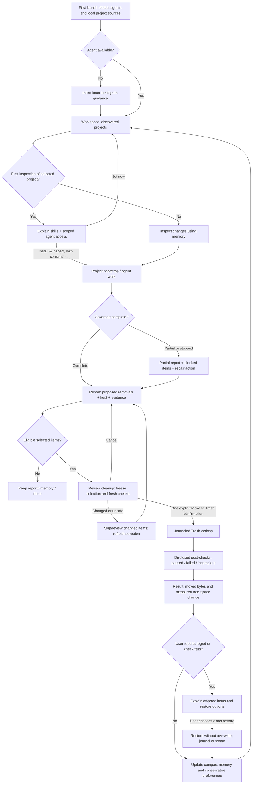

# Trace — Design & UX v0.1

Companion to [the PRD](prd.md) · 11 November 2026 (IST)

**Intent:** a colourful developer instrument, not a generic Mac cleaner or a Settings-window template. Minimal does not mean monochrome, and developer-native does not mean a wall of terminal output.

This specification describes the complete intended M2 experience. M0 has skills only; M1 implements its read-only subset and never teases enabled cleanup controls that do not work. All unvalidated visual numbers and behavior choices marked **Proposed** are starting decisions for dogfood, not immutable acceptance tests.

## 1. Design direction: “working traces”

### Principles

1. **Evidence is the interface.** Show what the artifact belongs to, why it exists and why the decision is credible. A pretty number cannot substitute for a source or uncertainty.
2. **Colour organizes; words authorize.** Use distinct artifact hues and separate semantic states. Always pair state with a label/icon. Green is not consent.
3. **One decision, one place.** Pick a project, inspect, select, confirm once. Never duplicate Scan/Run/Clean buttons or require dismissal of a celebration before showing the result.
4. **Dense, calm, fast.** Align paths and tabular numbers. Keep essential evidence visible, details adjacent and navigation instant. No giant whitespace cards, health scores or ornamental charts.
5. **Reversible by design, honest by default.** Explain what moved, what stayed, what could not be verified and whether free space actually changed. A failure is a usable state, not a dead-end alert.

### References: borrow an idea, not a skin

- **[Linear's UI redesign](https://linear.app/now/how-we-redesigned-the-linear-ui):** borrow low-noise chrome, aligned dense information and role-based light/dark tokens. Do not copy its sidebar, branding, issue terminology or exact palette.
- **[Raycast](https://www.raycast.com/):** borrow immediate keyboard navigation and contextual actions that do not interrupt a task. No launcher overlay, universal command menu or AI-chat tab merely because a developer tool has one.
- **[Ghostty's explicit keybindings](https://ghostty.org/docs/config/keybind):** borrow predictable, discoverable mappings and respect text-selection/copy behavior. No new global shortcuts or Accessibility permission just for navigation.
- **[Zed](https://zed.dev/):** borrow the adjacency of work, evidence and optional detail; keep the report legible alongside an inspector. Do not clone editor tabs, a code minimap or a terminal.

These are interpretations of public materials, not claims that a cited product implements Trace's flows. Trace's own identity is the **violet workspace, warm-light/ink-dark surfaces, multicolour artifact marks and precise mono measurements**, rather than copied chrome or a default SwiftUI Form.

## 2. Theme and component language

### Named palette: “Prism / Ink”

Follow system appearance initially, with Light/Dark/System in Settings. Solid, very slightly tinted surfaces; no gradient wallpaper, glass-on-glass, neon glow, traffic-light status dashboards or frosted panels. Keep native macOS window controls, menus, selection and accessibility behavior; build a deliberate custom content hierarchy.

**Proposed tokens — use these role names, not hardcoded colours in individual screens.**

| Role / token | Light: Prism | Dark: Ink | Use |
| --- | --- | --- | --- |
| `canvas` | `#F5F3FF` | `#14131D` | Window background, never a decorative gradient. |
| `surface` | `#FFFFFF` | `#1D1B2B` | Report list, inputs and main content. |
| `elevated` | `#EEEBF8` | `#262238` | Inspector, confirmation sheet, selected-project background. |
| `text.primary` | `#202033` | `#F4F1FF` | Essential labels, reasons and sizes. |
| `text.secondary` | `#626075` | `#B8B2C9` | Paths, provenance dates and supporting copy. |
| `line` | `#8B849F` | `#837A9A` | Functional control edges; quieter dividers may use a separate nonessential token. |
| `brand` | `#6D42C5` | `#B99BFF` | Primary action, active navigation and selection mark. |
| `on.brand` | `#FFFFFF` | `#191322` | Text/icons on brand fills. |
| `focus` | `#8054D5` | `#D3BEFF` | Visible keyboard outline, distinct from selection. |
| `safe` — Fern | `#16714E` | `#68D5A5` | Check + “Verified disposable”; never “guaranteed safe”. |
| `review` — Ochre | `#945B00` | `#F1C56B` | Hollow diamond + “Needs review” or “Partial”. |
| `critical` — Rose | `#B43C53` | `#FF98AD` | Lock + “Protected”; error uses warning icon and explicit copy. |
| `freed` — Glacier | `#006C86` | `#6DD7F0` | Measured free-space increase only, not selected bytes. |

**Category accents** are a 3 px leading mark, small icon or labelled text, not full-row background fills. Their job is recognition, not safety classification.

| Category | Light | Dark | Icon / explicit label |
| --- | --- | --- | --- |
| Caches — Honey | `#776005` | `#E7CF70` | Stack / Caches |
| Builds — Cobalt | `#3560B8` | `#92B6FF` | Hammer / Builds |
| Worktrees — Iris | `#8050A7` | `#CEABF5` | Branch / Worktrees |
| Containers — Lagoon | `#087780` | `#70D3DD` | Shipping box / Containers |
| Models — Orchid | `#A24178` | `#F3A0CC` | Layered cube / Models |
| Data / other project artifacts | `text.secondary` | `text.secondary` | Database or file / actual kind |

Use semantic colours only for labelled state and category hues only for labelled kind; do not infer state from a hue. A purple worktree can still be Protected. A selected row has a thin brand edge and a checkmark; hover uses elevated surface, not another state colour. Buttons use brand fill for the single primary action and neutral text/outline for secondary actions. A reversible Trash action stays brand-filled with an explicit action label; permanent tool-native removal must not masquerade as Trash.

Before shipping, check text contrast at least 4.5:1, large text and meaningful controls at least 3:1, in both themes and Increase Contrast. Adjust tokens rather than lowering contrast with arbitrary opacity. Disabled controls retain legible reasons; protected items are not rendered as unreadable dim text. Avoid tinted badge backgrounds unless their exact foreground pairing is checked.

### Typography

**Proposed:** SF Pro Text/Display for UI and SF Mono for paths, byte quantities, IDs and commands. These respect macOS while the layout and colour carry Trace's identity. Do not make every label monospace. Use tabular figures for measurements and elapsed time; keep full precision in accessible details.

| Role | Size / weight | Use |
| --- | --- | --- |
| Outcome / major measure | 28 pt semibold, tabular | One main outcome, never a wall of stats. |
| Screen/project heading | 20 pt semibold | Project or screen title. |
| Section | 15 pt semibold | Kept, Shared stores, Learnings. |
| Body / row title | 13 pt regular / medium | Essential explanation, controls. |
| Paths / sizes / commands | 12 pt mono regular | Secondary path, aligned measured size, copyable recipes. |
| Supporting metadata | 12 pt regular | Evidence source/date and stale/partial labels. |

No all-caps micro-labels below 12 pt. Respect larger text/accessibility preferences, allow wrapping and increase row heights instead of clipping. Elide long paths in the middle, preserving project context and the tail; inspector and copy/reveal expose the full path. Commands wrap in a selectable mono block and are never executed by clicking the text.

### Layout, spacing and components

**Proposed:** 4 pt base rhythm; gaps 4/8/12/16/24/32; window padding 24; content inset 16; 8 pt control radius, 12 pt sheet/inspector radius, 4 pt code-block radius. Dividers are 1 pt, no shadow stacks. Default window 1080 × 740 pt; support 840 × 600 pt and larger text. Inspector is about 320 pt when there is room; on narrow windows it replaces the report body with a breadcrumb back, preserving selection/scroll.

- **Chrome:** native title bar with a quiet Trace mark and current project breadcrumb. A project switcher appears only inside a project. Report/Memory are two text destinations, not five permanent sidebar sections. Global Settings lives in the app menu and one gear entry, not repeated on every screen.
- **Workspace:** one project list, not a dashboard of cards. Project name, root, last inspected/active evidence, memory state and known storage/completeness. One selected row determines the action. No per-row Inspect button beside a global Inspect button.
- **Report:** top scope/coverage line; one search/filter strip; flat artifact list; sticky bottom selection summary and the single primary action. Avoid giant stats. A row is roughly 72 pt when needed to keep the reason visible, not a rigid height test.
- **Row at rest:** checkbox or lock, name/path tail, allocated size or estimate marker, category label, semantic state and a one-line reason. Source/project identity is present for shared/cross-project entries. Never hide the reason behind hover.
- **Row details:** clicking the row opens the inspector; clicking its checkbox changes selection only. No double-click requirement. Inspector includes purpose, lifecycle, owner/consumers, freshness, evidence, recreation cost, live-use/source protection checks and “Why keep/remove?”. Full path and evidence can be copied/revealed through a contextual menu.
- **Filters:** one compact menu for category, state and shared/local; active chips can be removed. Search is project-local and matches paths/names. Selected count/bytes always refer to the entire selection, including filtered-out items, with an explicit “N selected outside this filter” link. Filtering never silently clears selection.
- **Shared artifacts:** a Shared label and consumer count; “Unknown consumers” when applicable. They never start checked. Exact shared evidence expands in the same inspector, not another nested dialog.
- **Empty/protected sections:** keep and unknown counts remain visible. They expand in place; no raw filesystem inventory dump and no hiding unknown bytes from coverage.

### Iconography, motion, sound and copy

- Use restrained 16 pt, consistent-stroke SF Symbols or original equivalents: branch, hammer, stack, shipping box, layered model; check, diamond, lock and warning have distinct shapes. Trace's original app/menu mark should evoke a routed line with an endpoint, not a broom, shield or copied brand glyph. Icon-only controls have labels for VoiceOver and tooltips; pointer hit areas are at least 28 pt, larger where practical.
- **Motion — proposed:** immediate checkbox/filter/keyboard state; 120–180 ms opacity/position for inspector or sheet; at most a gentle 4 pt transition. No spring bounce, confetti, animated lists, fake streamed typing or spinning brand mark. Reduce Motion removes positional movement. Indeterminate progress remains a neutral activity indicator; determinate progress is only for a known frozen item set.
- **Sound:** one short, quiet system-style completion tone on a successful result, at most once per run. Settings calls it **Freed sound** and defaults it on as a proposed choice. Obey system alert volume/mute preferences; never speak or play on error/cancel. Do not imply free space was reclaimed: if items only reached Trash, the visual outcome must say that; the tone means completed action, not verified physical savings. An unread/background result must not replay the sound when opened.
- **Voice:** terse, specific, developer-native, no alarm or “junk”. Say “Rebuildable from package-lock.json”, “Shared by 3 projects”, “In use — kept”, “Couldn’t verify 2 items”. Prefer “Move 6 items to Trash” over “Optimize now”. Never claim “Everything works” when only one check passed.
- **Bytes:** decimal GB/MB, labelled as allocated/estimated where appropriate; exact bytes available in details. Use “8.4 GB selected”, “8.1 GB moved to Trash”, “Free space change: +0.1 GB”. Negative free-space change is possible during concurrent activity and must not be hidden. Do not invent a “Freed 8 GB” hero from the selected total. Dates use the user's local timezone; full evidence timestamps show the zone.

## 3. End-to-end flow

An M1 report ends at read-only review/memory: no selection-driven Trash action. Installation and project-agent execution always require disclosed consent; discovery itself never means consent to install, execute project code or clean.

## 4. Screen inventory

Every screen has at most one filled primary action. Contextual alternatives are text/outline controls, not competing calls to action.

| Screen/surface | Purpose + essential information | Single primary action | Secondary actions | Main states |
| --- | --- | --- | --- | --- |
| First launch | Detected agents/version/availability, selected harness/provider disclosure, permitted discovery sources | **Find my projects** | Choose agent; learn about data access | Detecting, none found, signed out, incompatible CLI, ready |
| Workspace | Discovered project roots, source of discovery, activity/memory/freshness, last report | **Inspect project** for selected row; **Open report** if a fresh report is being resumed | Add/exclude/reveal project; project search | Discovering, no projects, stale, inaccessible, ready |
| First-project setup sheet | Three skills, exact install locations/config diff, provider context, project/store scope, first-run purpose | **Install & inspect**; **Inspect project** if skills already verified installed | Not now; inspect configuration changes | Ready, install conflict, trust required, failed/rolled back |
| Activity | Project/harness, stage, elapsed time, evidence/byte counts, scope, partial coverage | **Stop** | Show bounded diagnostic detail | Discovering, researching, inspecting, stopping, timeout |
| Project report | Remove/keep/unknown findings, reasons, freshness, selection/bytes and coverage | **Review cleanup (N)** in M2; **Done** in M1 | Filter/search; row details; inspect changes via toolbar menu, not second prominent Run button | Complete, stale, partial, none eligible, agent failed |
| Artifact inspector | Provenance, consumers, three safety questions, recreation, source links | No additional filled action; inherits report primary | Select checkbox if eligible; scoped question; copy/reveal | Verified, inferred, shared, protected, stale |
| Cleanup confirmation | Frozen exact items, totals, new safety-check results, disclosed post-check scope | **Move N items to Trash** | Cancel; expandable full selection | Checking, ready, blocked/changed, journal unavailable |
| Cleanup activity | Known item count, current action, moved/skipped/failed totals | **Stop after current item** | Expand completed journal entries | Moving, stopping, partial failure; post-check stage |
| Result | Selected/moved/space-change values; skipped/failed and check outcomes; new learnings | **Done**; **Review recovery** replaces it when attention is needed | Report a problem; inspect journal/details | Success, partial, cancelled, couldn't verify, regression |
| Recovery | Affected items, original destinations, available Trash entries, conflicts | **Restore N items** after explicit selection | Back; reveal conflicts | Ready, missing Trash item, destination occupied, restored/partial |
| Memory / Learnings | Project index, evidence-linked notes, rules and feedback history | **Save changes** only while editing; none in read view | Edit/toggle; inspect evidence; remove note/rule with inline undo | Read, edit, stale, conflict, no memory |
| Settings | Agent/skills, access, appearance/sound and privacy controls | Contextual **Apply changes** only when an explicit staged config change needs it; otherwise none | Re-detect; manage skill install; open OS permission page | Connected, signed out, permission denied, config drift |
| Menu bar popover | Current project/stage, last report date/state and truthful moved/space facts | **Open Trace**, landing at the relevant report/activity | Stop if working; Settings; Quit | Idle, working, stopped, result available, needs attention |

“No primary” is deliberate for a read-only inspector or simple settings surface; do not invent a button just to fill the slot.

## 5. Detailed behavior by flow

### A. First launch and discovery

One useful setup surface, not a four-page tour. Agent discovery is local and bounded; list only detected harnesses with a visible unavailable state for a previously selected one. Choose automatically only if exactly one compatible agent exists; otherwise ask with a radio selection. An automatic availability check is not a hidden paid prompt: explain before a provider-backed probe and do not repeat it every launch.

Describe project sources before **Find my projects**: permitted workspace metadata, IDE recents and Git-root evidence. That click begins project discovery, not cleanup. Source toggles are visible; raw transcript access is not silently enabled. Request the narrow folder permission only when necessary. Full Disk Access is an **optional, explained repair for a specific blocked surface**, never a compulsory “grant access to your whole Mac” screen. If a location remains inaccessible, show the missing scope and keep the rest useful. Do not restart discovery merely because a permission dialog returned; verify access, then resume the affected work only.

No agent: show the detected PATH/install diagnosis, official install instructions and one **Re-detect** recovery action. Sign-in happens in the supported harness flow, not a password field inside Trace. Discovery can still show already-permitted local project metadata, but agent analysis remains blocked and clearly labelled. Do not imply Trace needs an API key if the harness already has a supported account.

Workspace shows the evidence for “active”, not a magical label. Selecting a project previews its root and related stores. Exclude removes it from future discovery/report suggestions, not disk. Add is an escape hatch for missed/non-Git work, not the default funnel. A moved root offers **Locate project** and preserves the stable project history; an archived project remains intentionally accessible but does not receive default suggestions.

### B. First run per project

**Inspect project** opens a setup sheet only when skills or initial consent are missing. Show what the three skills do, harness-specific install paths, exact managed config changes and the expected provider boundary. Preserve existing user configuration. If the harness requires a trust prompt or new session, say so and verify installation; do not show “Installed” merely because files were written. Failures explain changed/rolled-back configuration and permit retry of this step, not all onboarding.

Use a single **Install & inspect** action for the explicitly described sequence. It installs only the approved changes and starts the disclosed project inspection: read-only with respect to project artifacts, with writes limited to the approved Trace configuration and memory. “Not now” returns to Workspace with the project intact. Already-installed skills skip installation copy and use **Inspect project**. Never silently accept a new host trust prompt or broaden tool permissions.

The bootstrap inventories existing storage, links project-owned stores and creates baseline notes. Label inferred legacy ownership “Discovered on first inspection”; never fake an agent-created event. Existing memories from another harness are imported only as evidence with provenance, not as automatically trusted policy. First-run progress explains that later reports can reuse this baseline without promising they will always be faster.

### C. Steady-state inspection and progress

Opening a saved report does not run an agent. Show “Last inspected …” and stale markers. **Inspect changes**, reached from the project's context/toolbar action, starts the next agent run with previously approved, unchanged scope. New permissions, new stores or provider-boundary changes require explicit disclosure before proceeding.

Reuse the small memory index, refresh changed facts and show phases such as “Reading project memory”, “Checking build outputs”, “Verifying shared consumers”, “Preparing report”. Publish useful completed evidence without jitter or re-sorting the row under the pointer. Do not expose chain-of-thought; show actions, structured evidence and bounded logs with secrets redacted.

Stop immediately changes to “Stopping…” and disables additional starts. Terminate owned agent/tool processes safely; do not kill a user's unrelated session. Keep completed results marked partial; a stopped/old generation cannot overwrite a new report. New work is single-flight in v0: other project inspection buttons say why they are unavailable rather than silently queueing unlimited agents. **Proposed**, validate whether sequential project runs are sufficient in dogfood.

### D. Review and one cleanup confirmation

Results are decision rows, not a chatbot transcript. Sort first by selectable recommendation then measured allocation; protect row identity when updates arrive. Each recommendation exposes reason and scope/completeness, and details answer recreation, dependencies and criticality. Optional scoped questions live in the inspector, not both a floating Ask button and repeated per-row buttons.

Only freshly verified, nonshared disposable artifacts may start selected under a validated policy. Shared items, unknowns, partial validation, prior regrets and protected items never do. Users can select additional eligible rows deliberately. A protected lock cannot be bypassed with a checkbox. Age or confidence alone cannot turn a row safe.

**Review cleanup (N)** freezes the selection and opens the **only** cleanup confirmation. It performs fresh identity/use/source/protection checks with a spinner and explicit **Cancel**. It lists exact items, allocated selected bytes, shared caveats, any tool-specific scope and the verification planned afterward. Verification that runs code/services is opt-in here; skipping it means the result may be incomplete, not automatically failed.

If selected items changed, show what was skipped and require returning to the report to refresh that selection; never silently add replacements. If all are blocked, there is no enabled commit button. A missing durable journal blocks the action. On success, **Move N items to Trash** is one explicit click, not “Run” → “Clean” → “Are you sure?” → “Yes”. No keyboard shortcut or default Return activation commits it accidentally; Cancel is the default sheet action. Escape cancels the sheet, never silently trashes.

Tool-native irreversible operations are **report-only in the initial release**. Never mix a prune command into a “Move to Trash” selection. Any future support must have a resource-specific action/recovery explanation and distinct explicit approval, not an extra hidden cleanup phase.

### E. Cleanup, results and honest “freed”

During Trash actions show “4 of 9 moved”, current item and per-item skip/failure reasons. Stop takes effect at a safe item boundary. Completed actions are journaled; do not promise rollback on Cancel. A crash/interruption reopens an “Interrupted cleanup” result from the journal; it never resumes deletion automatically.

Post-checks are separate: stopped checks do not restore or move more files. Compare known baselines when available; a failing build without a passing baseline is an observed failure, not proof cleanup caused it. Show **Passed / Failed / Couldn't verify** and check scope. Link any new failure only to evidence, not an invented causal story.

The result appears immediately after work, with no success modal on top:

- Headline “Moved 8.1 GB to Trash” or “Moved 4 items · 2 skipped”.
- Secondary “Selected: 8.4 GB” and “Measured free-space change: +0.1 GB”, or “Unavailable — couldn't read capacity”. Label the measurement interval and concurrent-activity caveat in details.
- A **Freed** hero is permitted only for a measured positive free-space delta, labelled “Measured free-space increase”, not as the sum of deleted file sizes. Keep the moved total visible and explain that snapshots/shared blocks/Trash may retain allocation.
- Post-check outcome, skipped/failed entries, and new learnings are visible sections, not three extra screens.
- One optional contextual hygiene tip, only if it is grounded in this run and not a duplicate of a learning. Dismissal informs preferences; closing a section is not a rejection of its contents.

**Done** returns to the project report/Workspace without deleting its history. A regression or expressed regret replaces Done with **Review recovery**; Back remains secondary. “Couldn't verify” offers investigation/recovery without claiming breakage. No nag to empty Trash and no “boost your Mac” upsell.

### F. Recovery and feedback

**Report a problem** is available on Result and the corresponding history entry, so later regret is not lost after dismissing a toast. Open an inline explanation/affected-item choice; reason is optional and never blocks access to restore. Record the regret immediately, even if no files are restored or Trash is already empty. It makes matching future recommendations more conservative.

Recovery shows exact journaled items, original destinations and availability. No bulk automatic restore. A user selects the subset and presses **Restore N items**; this is the explicit recovery consent, with no redundant second yes/no. Destination conflicts are never overwritten: leave affected entries blocked and offer reveal/alternate destination choice. Missing Trash entries explain the limit honestly; there is no guaranteed recovery promise.

A checkbox toggled during selection is provisional. Commit keep feedback on an explicit Keep/dismiss decision or on confirming cleanup after deliberately deselecting a recommendation, not on every accidental click. Merely opening/leaving a report or having an initially unticked row is not a keep decision; toggling back before acting is not multiple feedback events. “Keep this time” is not a permanent never-touch rule. An optional **Always keep this pattern** control previews the specific rule it would add. User-created protections apply immediately; newly proposed aggressive rules remain disabled until explicitly approved with their exact scope.

### G. Memory / Learnings

Two clearly separated views within the same project destination:

- **Project memory:** purpose, lifecycle notes, ownership/consumer map, recreatability and freshness. Index first; details/evidence on demand. No raw transcript viewer or browsing hundreds of ledger files as the primary interface.
- **Preferences / Learnings:** plain-language rules, source feedback, scope, enabled state and whether confirmed. Show “Suggested — not active” for more aggressive proposals.

Select a note to read/edit beside its evidence. The primary becomes **Save changes** only while editing; Cancel discards the draft. An edit to a factual claim is a user-authored correction with provenance; it does not erase the original ledger event. Concurrent agent/user edits show a diff and require an explicit merged choice, never last-writer-wins data loss. Rules can be toggled and removed with inline undo; removing a note does not remove its artifact. Memory/history retention deletion belongs to a clearly labelled privacy control, not a Trash-artifact button.

Stale/unverified notes display status and the last evidence time. **Inspect changes** validates project facts in the usual run, not an undisclosed per-note agent loop. Broken/missing evidence remains visible as unknown. No-memory state says “No project memory yet” and points to the existing Inspect action rather than adding a competing “Generate memory” action.

### H. Settings and menu bar

Settings sections, with concise controls rather than a giant generic form:

- **Agent & skills:** current harness/version/status, installation scope and managed configuration, toggles per skill, explicit managed uninstall that preserves user configuration. Re-detect is a repair action, not a mandatory step per run. Switching agent requires the same disclosed verification/skill setup for the new one; no repeated entire onboarding.
- **Projects & access:** excluded roots, never-touch list, discovered sources, blocked project/store permissions. Adding a never-touch rule is immediate; removing protection explains that it changes eligibility but never runs cleanup. Full Disk Access link appears only alongside a location that needs it, with why.
- **Appearance & behavior:** System/Light/Dark, Freed sound, menu-bar presence. No aggressiveness slider whose meaning is vague; change explicit rules instead.
- **Privacy & memory:** local storage location, retention/size, scope/provider disclosure, reset/export choices with exact contents and redaction. Resetting learned preferences does not remove artifacts or erase the cleanup journal silently. Export is user-invoked, local by default; sharing/uploading is a separate explicit action.

**Proposed menu-bar behavior:** visible while Trace is running, no login item by default. One monochrome original glyph works on either system menu-bar appearance; a small labelled status inside the popover communicates work/attention, not colour alone. No live “12 GB reclaimable” number that becomes an unsupported promise. Popover is roughly 340 pt wide: current project, stage or last report timestamp, coverage/result sentence, **Open Trace**. During a run a secondary **Stop** uses the same operation as the main window. Opening lands directly on the current run/result, not a second dashboard. Never clean, install skills or launch a fresh agent from a one-click menu-bar shortcut.

Closing the popover does not stop work in an open main window. **Proposed:** closing the main window stops active foreground work safely and leaves the app idle in the menu bar; if menu-bar presence is disabled, closing the last window quits. Quit also stops owned work safely and saves the journal; completed moves stay completed. There is no hidden scanning after the window closes. Validate this window lifecycle with Gopi before implementation rather than inheriting Shed's contradictory history.

## 6. State and repair matrix

| Condition | What the user sees | Recovery; what must not happen |
| --- | --- | --- |
| No projects discovered | “No projects found from these sources.” Source coverage is visible. | Add a project or enable a source. No whole-disk scan fallback. |
| No eligible cleanup | “Nothing worth removing in this project.” Kept/unknown allocation remains visible. | Done; no pressured “deep clean” button. |
| Permission denied | Exact project/store and omitted coverage; not “0 bytes”. | Narrow access/OS permission action or continue partial. No repeated access prompt loop. |
| Agent missing/signed out | Harness-specific unavailable state and existing saved report. | Official setup/sign-in guidance and explicit retry. No silent provider switch. |
| Agent timeout/provider error | Completed evidence retained, elapsed stage and concise error. | Retry the failed analysis step on existing evidence; disclose any new provider call. No repeat installation or full rescan by default. |
| Unknown shared consumers | “Shared · consumers not fully verified”, unticked. | Inspect evidence or keep. No “last used months ago” shortcut to pruning. |
| Partial/limit reached | Count of examined/unverified/skipped items, known bytes and missing scope. | Inspect a specific remaining scope explicitly; verified eligible items may still be reviewed, but incomplete candidate safety stays blocked. |
| File changed/in use | Item skipped with fresh reason, selection total updated. | Refresh/review; do not retry deletion in a loop. |
| Nearly full disk | Trace journal/memory budget status; action disabled if safe journaling cannot work. | Small bounded/read-only report; no mandatory database spill or broad auto-prune to make space. |
| Stale/moved project | Saved report labelled stale or root missing; history retained. | Locate/exclude project; no rebinding provenance by name alone. |
| Cancelled/interrupted | What completed, what did not, and action journal availability. | Open partial report/recovery. Never show an unqualified success or auto-resume cleanup. |
| Failed/incomplete verification | Exact failing/unchecked checks and available recovery. | Investigate or explicit restore; never claim a regression without a baseline or auto-restore. |
| Restore conflict/missing Trash | Exact blocked destination or unavailable source. | Reveal or choose alternate destination; never overwrite or claim recovery completed. |
| Memory parse/write/conflict error | Memory not saved/reused; app report labelled accordingly. | Repair/quarantine with consent, preserve original. No silent overwrite or acting from partial corrupted policy. |

Errors are inline at the source, with one specific repair action. Modal interruption is reserved for action consent or an OS-required boundary. Error text is selectable; diagnostics redact paths/secrets unless explicitly revealed locally. Do not expose raw provider stack traces as the only explanation.

## 7. Keyboard, accessibility and focus

- Tab reaches every interactive control in reading order. Arrow keys move list focus, Space toggles an eligible checkbox, Enter opens focused row details, Escape closes inspector/sheet or dismisses popover. Escape does not implicitly cancel work while the user is editing a question.
- `⌘F` focuses the current search; `⌘,` opens Settings; `⌘C` copies actual selected text. No global hotkey, command palette or destructive Run shortcut in v0. A focused commit button may be activated through standard explicit keyboard focus, not a global/default Return handler.
- After a sheet closes, return focus to its invoking action; after a row disappears, retain a sensible adjacent focus. After a repair, focus the repaired item rather than the top of the screen.
- VoiceOver announces project scope, item kind/state, selection, estimated/completeness labels and the relationship between reason and artifact. Announce stage transitions and completed totals, not every filesystem entry.
- Colour, hover, motion and sound are never the only channels. Visible essential evidence works without hover. Respect Reduce Motion, Reduce Transparency, Increase Contrast and larger text. Avoid truncating the only explanation; use row wrapping and inspector disclosure.
- Native text selection, contextual menus and copy/reveal behaviors are preserved. Expand/collapse state and selected items survive filtering and navigation; confirmation always revalidates them.

## 8. Deliberately removed interactions

- **No whole-Mac / Quick / Deep scan mode switch:** scope is projects and their related stores, not scan marketing tiers.
- **No tour, welcome carousel or compulsory folder picker:** begin with agent detection and automatic discovery; manual add is a fallback.
- **No Full Disk Access gate for everyone:** ask only when a concrete blocked project/store justifies it.
- **No repeated “Test agent” step:** detect and verify once when necessary; repair only on failure or configuration change.
- **No duplicate Scan/Inspect/Run/Clean buttons:** one project action, one review-selection action, one final explicit Trash consent.
- **No “Are you sure?” after the detailed confirmation:** it adds friction without new evidence.
- **No one-click cleanup in the menu bar or destructive keyboard shortcut:** too little scope/evidence for safe consent.
- **No floating general chat plus per-row Ask plus separate chat tab:** one scoped question surface inside the inspector covers the need.
- **No full inventory tree, pie chart, health score, performance meter or category sidebar:** they dilute project decisions and suggest whole-Mac coverage.
- **No mandatory keep-reason survey:** feedback is optional and local; do not turn a safe choice into homework.
- **No success interstitial, confetti, looping sound or “empty Trash now” prompt:** results must remain honest, inspectable and calm.
- **No auto-prune/auto-restore/auto-resume after crash:** a saved plan or memory does not constitute current consent.
- **No always-visible “Save” for immediately applied appearance settings:** save only staged text/config changes where committing is meaningful.
- **No permanently expanded logs or multiple evidence modals:** structured detail is adjacent; raw diagnostics are a secondary affordance.

## 9. Assumptions and validation

These choices extend the agreed product scope; they are **proposed design**, not established user research:

- **Single project / single active run in v0** is sufficient. Dogfood across Gopi's concurrent work; add a batch flow only if manual repetition is a real problem.
- **Workspace + report + adjacent inspector** can show evidence without a permanent sidebar or chart dashboard. Prototype complete, partial, 100-row, long-path and shared-consumer cases before freezing layout.
- **Palette, dimensions, type scale and sound default** feel distinctive and usable. Validate in light/dark, with keyboard/VoiceOver, contrast settings, larger text and on Gopi's actual display; adjust tokens instead of freezing pixel tests.
- **Closing the main window should stop work but leave a quiet menu-bar app.** Confirm with Gopi; no hidden scan is the safety invariant either way.
- **Verified disposable nonshared outputs may be preselected.** Start more conservative until real evidence supports this rule; preserve the unconditional shared/unknown/regret/protected exclusions.
- **Memory editing and project bootstrap remain understandable without separate transcript/chat navigation.** Observe repeat-session reuse and a real correction/conflict, not only happy-path mockups.

Follow the PRD's learning approach: no hard UI tests locked up front. Use working prototypes and disposable-data dogfood; add focused checks after behavior stabilizes, particularly action boundaries, accessibility and journal/recovery states. This document is thorough about intended behavior, not a mandate to build every setting before learning from M0.
